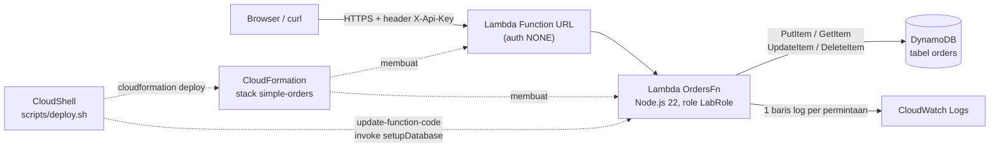

# Simple Orders

Aplikasi web sederhana untuk mencatat pesanan kantin. Pembeli membuat pesanan, mengeceknya dengan ID, menandainya diterima, atau membatalkannya. Dibuat untuk AWS Academy Sandbox dengan Node.js 22, tanpa framework dan tanpa library tambahan selain AWS SDK v3 (sudah tersedia di runtime Lambda).

## Arsitektur (as-built)

Diagram ini sesuai dengan yang ter-deploy di AWS Academy Sandbox (region `us-east-1`).



- **Satu Lambda (`OrdersFn`)** menyajikan halaman web (`GET /`, `/style.css`, `/app.js`) dan API `/orders`. Tidak perlu S3 atau API Gateway.
- **Tanpa S3 dan tanpa Custom Resource.** CloudFormation hanya membuat fungsi (kode placeholder), Function URL, dan izin. `deploy.sh` mengunggah kode dengan `aws lambda update-function-code`, lalu membuat tabel dengan memanggil `OrdersFn` langsung (`{"action":"setupDatabase"}`). Cara ini dipakai karena user sandbox tidak boleh `CreateTable`, sedangkan `LabRole` boleh.
- **Action tabel hanya lewat invoke langsung.** Event yang punya `requestContext` (dari Function URL) selalu diproses sebagai HTTP, jadi action tidak bisa dipicu dari internet.
- **Autentikasi** memakai header `X-Api-Key` dengan satu kunci pembeli (`KEY_PEMBELI`). Kunci ini dikirim sebagai parameter CloudFormation `NoEcho` dan tidak pernah dicetak ke log. Tidak ada role: siapa pun yang memegang kunci boleh memakai semua rute.

## Layanan AWS yang dipakai

| Layanan | Dipakai untuk | Dibuat oleh |
|---|---|---|
| AWS Lambda (`OrdersFn`, Node.js 22) | API CRUD dan halaman web | CloudFormation (kode diunggah `deploy.sh`) |
| Lambda Function URL | Endpoint HTTPS publik | CloudFormation |
| Amazon DynamoDB (tabel `orders`, on-demand) | Menyimpan pesanan | `deploy.sh` lewat action `setupDatabase` |
| Amazon CloudWatch Logs dan metrik Lambda | Log tiap permintaan, error, grafik pemanggilan | Otomatis oleh Lambda |
| AWS CloudFormation (stack `simple-orders`) | Membangun ulang resource di setiap sesi | `deploy.sh` |
| IAM role `LabRole` | Izin Lambda ke DynamoDB dan CloudWatch | Bawaan sandbox |
| AWS CloudShell | Tempat menjalankan skrip deploy, tes, dan teardown | Bawaan console |

## API

Semua rute `/orders` wajib memakai header `X-Api-Key`. Balasan berupa JSON, dan error berbentuk `{"error": "pesan"}`.

| Method | Path | Kunci | Sukses |
|---|---|:-:|---|
| `POST` | `/orders` | wajib | `201` pesanan baru |
| `GET` | `/orders/{id}` | wajib | `200` pesanan |
| `PUT` | `/orders/{id}` | wajib | `200` pesanan setelah diubah (misalnya `{"status":"done"}` = diterima) |
| `DELETE` | `/orders/{id}` | wajib | `200` `{"message","orderId"}` (pesanan dibatalkan) |
| `GET` | `/`, `/style.css`, `/app.js` | tidak | halaman web |

Selain rute HTTP, `OrdersFn` menerima dua action lewat `aws lambda invoke` (butuh kredensial AWS): `{"action":"setupDatabase"}` untuk membuat tabel (atau memakai ulang), dan `{"action":"deleteDatabase"}` untuk menghapus tabel.

Urutan pengecekan:

1. `401`: kunci tidak ada atau salah
2. `404`: rute tidak ada
3. `400`: input salah (JSON rusak, field tidak valid, ID bukan UUID)
4. `404`: pesanan tidak ditemukan

Error tak terduga dibalas `500` dengan pesan umum. Detailnya hanya ada di log.

Contoh:

```bash
source .env
curl -X POST "$API_URL/orders" -H "X-Api-Key: $KEY_PEMBELI" \
  -H 'Content-Type: application/json' \
  -d '{"customerName":"Budi","item":"Nasi goreng","quantity":2}'

curl -X PUT "$API_URL/orders/<orderId>" -H "X-Api-Key: $KEY_PEMBELI" \
  -H 'Content-Type: application/json' -d '{"status":"done"}'
```

## Data pesanan

| Field | Tipe | Aturan |
|---|---|---|
| `orderId` | String (PK) | UUID, dibuat server |
| `customerName` | String | 1–100 karakter (spasi di awal/akhir dibuang) |
| `item` | String | 1–100 karakter |
| `quantity` | Number | bilangan bulat > 0 |
| `status` | String | `pending` atau `done`. Selalu `pending` saat dibuat. |
| `createdAt` | String | waktu ISO 8601 UTC, dibuat server |

- `POST` hanya menerima `customerName`, `item`, dan `quantity`.
- `PUT` menerima sebagian dari `customerName`, `item`, `quantity`, dan `status` (minimal satu).
- Field lain ditolak dengan `400`.

## Keamanan dan observability

- **IAM:** `OrdersFn` memakai `LabRole` karena sandbox tidak mengizinkan membuat role sendiri. Role ini lebih luas dari yang dibutuhkan (bukan *least privilege*). Ini dicatat sebagai batasan.
- **Tidak ada rahasia di Git:** kunci API dibuat acak oleh `deploy.sh` di CloudShell, disimpan di `.env` (masuk `.gitignore`), dikirim ke CloudFormation sebagai parameter `NoEcho` (tampil `****`), dan tidak pernah dicetak ke log. Unit test memastikan kunci tidak muncul di log.
- **Akses API:** Function URL publik, tapi semua rute `/orders` wajib `X-Api-Key`. Kunci dibandingkan dengan waktu konstan (mencegah *timing attack*). Input divalidasi, dan error tak terduga hanya dibalas pesan umum.
- **Observability:** setiap permintaan menghasilkan satu baris log JSON `{"method","path","status"}` di CloudWatch Logs. Error ditulis lengkap di log. Tab **Monitor** di Lambda menampilkan jumlah pemanggilan, durasi, dan error.

## Verifikasi

| Tes | Perintah | Yang dibuktikan |
|---|---|---|
| Unit test (lokal) | `npm test` | 23 tes logika: CRUD, validasi, urutan error, kunci tidak bocor ke log |
| API end-to-end | `bash scripts/test-api.sh` | 4 operasi CRUD dan error 401/400/404 di endpoint asli (10 tes) |
| Persistensi | `bash scripts/test-persistence.sh` | Pesanan tetap ada setelah Lambda di-restart |
| Failure/recovery | `bash scripts/test-failure-recovery.sh` | Kode rusak ter-deploy → API 502 dan error di log → `deploy.sh` → API pulih, data utuh |

Semua skrip menyimpan hasilnya di folder `out/`. Screenshot bukti ada di [docs/testing-evidence.md](docs/testing-evidence.md).

## Batasan dan trade-off

| Keputusan | Alasan | Konsekuensi |
|---|---|---|
| Lambda Function URL, bukan API Gateway | API Gateway diblokir di sandbox | Tidak ada throttling/usage plan bawaan |
| Satu kunci API, bukan login per pengguna | Cognito tidak tersedia, aplikasi hanya punya satu jenis pengguna (pembeli) | Siapa pun yang tahu kunci dan ID pesanan bisa mengubah pesanan itu |
| Tabel dibuat lewat Lambda, di luar CloudFormation | User sandbox tidak boleh `CreateTable` | Tabel harus dihapus lewat `teardown.sh`, bukan hanya hapus stack |
| `LabRole` | Tidak bisa membuat IAM role | Hak akses lebih luas dari yang dibutuhkan |
| Tidak ada `GET /orders` (daftar semua) | Sesuai spesifikasi 4 endpoint | Pesanan dicari dengan ID |

## Struktur folder

```
src/
  index.js                  handler OrdersFn: routing, cek kunci, sajikan web/
  handlers/
    createOrder.js          POST /orders
    getOrder.js             GET /orders/{id}
    updateOrder.js          PUT /orders/{id}
    deleteOrder.js          DELETE /orders/{id}
    setupDatabase.js        action setupDatabase / deleteDatabase (buat/hapus tabel)
  utils/
    auth.js                 cek X-Api-Key (kunciBenar)
    dynamodb.js             DynamoDB client + DocumentClient + TABLE_NAME
    validate.js             validasi input pesanan
    response.js             helper balasan JSON
  web/
    index.html, style.css, app.js   halaman web (HTML + JS biasa)
infra/template.yaml         CloudFormation: OrdersFn (placeholder), Function URL, 2 izin
scripts/
  deploy.sh                 cloudformation deploy -> update-function-code -> setupDatabase -> .env
  test-api.sh               tes end-to-end dengan curl (10 tes)
  teardown.sh               deleteDatabase (kecuali RETAIN=true) -> hapus stack
  test-persistence.sh       tes data tetap ada setelah Lambda di-restart
  test-failure-recovery.sh  skenario kode rusak -> deteksi -> pulihkan
tests/orders.test.js        unit test (node:test + DynamoDB tiruan)
docs/deployment-plan.md     rencana deploy, verifikasi, rollback, persistensi
docs/testing-evidence.md    daftar bukti pengujian (screenshot dan output)
docs/demo-script.md         naskah video demo 3-5 menit
```

## Deploy (AWS CloudShell, us-east-1)

```bash
git clone <url-repo> simple-orders && cd simple-orders
bash scripts/deploy.sh               # aman dijalankan berulang
bash scripts/test-api.sh             # harap: 10 OK, 0 GAGAL
bash scripts/test-persistence.sh     # harap: HASIL: LULUS
bash scripts/test-failure-recovery.sh  # harap: HASIL: LULUS
grep KEY_PEMBELI .env                # kunci untuk halaman web (jangan dibagikan)
```

Buka `API_URL` di browser lalu tempel `KEY_PEMBELI`.

Untuk membongkar:

```bash
bash scripts/teardown.sh               # hapus tabel (beserta data) + stack
RETAIN=true bash scripts/teardown.sh   # simpan tabel; deploy ulang -> data tetap ada
```

Detail langkah, verifikasi, rollback, dan skenario persistensi ada di [docs/deployment-plan.md](docs/deployment-plan.md).

## Tes lokal

Butuh Node.js 22 atau lebih baru. **Tidak perlu `npm install`.** Test mengganti modul `src/utils/dynamodb.js` dengan DynamoDB tiruan berbasis `Map`, jadi tidak ada panggilan ke AWS.

```bash
npm test
```

Yang diuji:

- `401` tanpa kunci atau kunci salah, dan `404` rute
- Alur `201`/`200`, `400` validasi, `404` pesanan tidak ada, dan `500` saat DynamoDB gagal
- Urutan pengecekan
- Kunci API tidak pernah muncul di log
- Action `setupDatabase` / `deleteDatabase` (termasuk aman diulang), dan action yang dikirim lewat URL diabaikan
